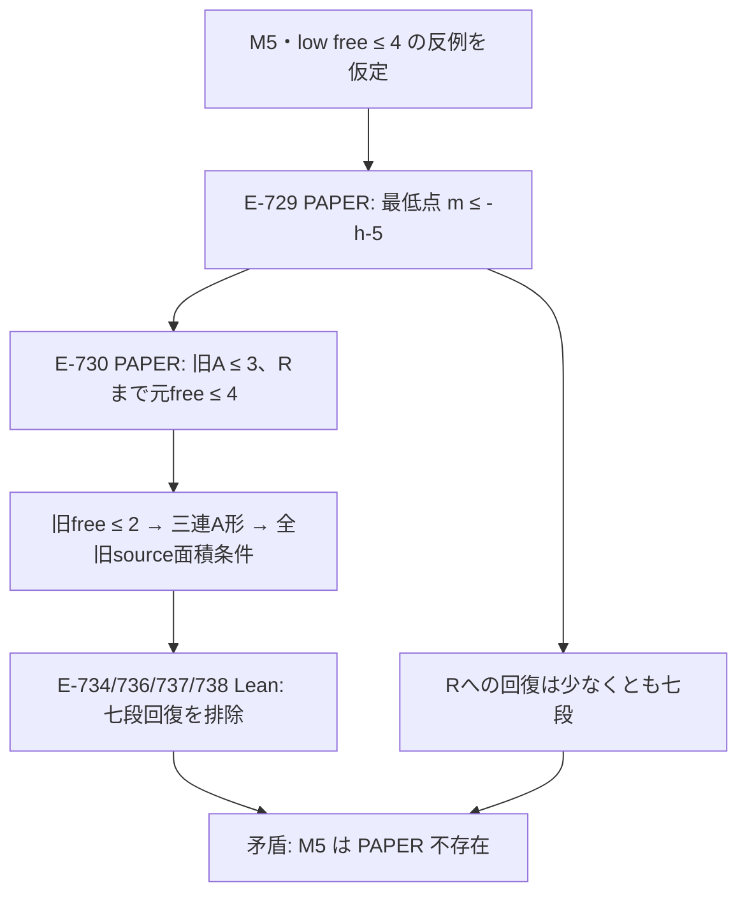

# 2026-11-17 evening: M5・low free4 の排除

**M=5・low free<=4では、必要な24/16間隔の供給元族を同じ元履歴に準備できない、という紙上証明を得た。** 前史の深さ・上昇幅・長さを制限せず、元の履歴と全供給元を保持する。R以後の高いfreeを検討する前に、必要な深い最低点からRへ戻ること自体が不可能になる。全体の判定は **E-735 PROVED-PAPER、全体未Lean・人間レビュー未**。一般Mの費用不等式、C1、全射性は未証明。

正本は[証明ノート](RESEARCH_NOTE_2026-11-17_POST_RETURN_HIGH_FREE.md)、[意味監査](data/post_return_high_free_20261117/SEMANTIC_AUDIT.md)、[再現packet](data/post_return_high_free_20261117/README.md)。標準Recaman軌道がこの抽象履歴を実現するという主張は加えていない。

## 何が行き詰まりを変えたか

E-729の全訪問会計から、反例なら元の最低高さは-h-5以下。E-730により、最後の最低点vより前のAは高々3個で、最初の帰還Rまでの**元Nat0の総free**は高々4個になる。最低点直後の二つのAは元freeなので、vより前のfreeは高々2個。旧Aが3個なら3個は連続しなければならない。

この元の並びから、すべての旧供給元が持てる面積を制限した。元の供給をすべて許し、さらに余分な供給まで許すモデルでも七段上昇できない。ところがRへの帰還には少なくとも七段必要なので矛盾する。供給元の個数だけでなく、**元free予算が旧Aの並びと面積を制約すること**が今回の新しい接続である。



図の旧free<=2を生成する最低点直後の二free、および元の親条件からのE-729/E-730接続は紙上である。Leanだけで無条件M5を証明した図ではない。

## 証拠と仮説カードの状態

| 対象 | 最終状態 | 最も強い根拠・限界 |
|---|---|---|
| RH / PC5 / 最初の七段帰還 | PROVED-PAPER E-735 | 任意深さ・上昇・長さの原履歴に対する完全な依存列。一般Mは未解決 |
| 旧source半径・元free輸送 | PROVED-LEAN E-732 | old A<=p / 未来A高さ帯bを明示して全source半径2p+b、双方向の窓輸送。freeからpの一般上界は未供給 |
| 四根の回復モデル | PROVED-LEAN E-734 | 151節点のkernel証明と任意の元長さKへの帰納。元source admissionは明示仮定 |
| 元床の面積/偶奇 | PROVED-LEAN E-736 | 実際のA始点高さの和から全K・全rで導出 |
| 全旧窓のadmission生成 | PROVED-LEAN E-737 | 元floor/count/三連A形から生成し、元free会計のまま回復定理へ |
| 元A3/free2から三連A形 | PROVED-LEAN E-738 | 実Win3を元countから抽出し、他の全時計がSと証明。床から終端S長>=3も導出 |
| 全A<=7/free4 | REFUTED E-731 | 元正履歴 SSAAASSSSAAAASA はA8/free4 |
| R後にlow freeが無ければ正keyは作れない | REFUTED E-733 | 全m>=8の元正履歴。m8は両高さoffset6/19、旧low free39355。PC5反例ではない |

三連A条件だけを捨てた弱モデルには `AAAASAAASSASASASAAA` があり、relaxed free4で七段に達する。最初に違反する旧面積はj3/C1で、単なる床の上下界・偶奇には合うが三連Aの面積一覧には入らない。これは同じ旧履歴を実現した反例ではなく、必要な過去の情報を落とすことへの対照例である。元履歴の境界例 `S8 AAAA S AAA` は本当にfree4/上昇6、最後にAを足すとfree5/上昇7となり、全供給元を二方向から照合した。

## 失敗と停止

旧49型の完全source探索は540節点で閉じたが、その直接Lean certificateは固定60CPU上限に達し **STOPPED**。失敗源はpacketのstopped内に保存し、root/Auditから除外した。資源追加・tactic/import変更・単なる分割で再試行していない。新しい元床の三角面積と三連Aの分類による四根151節点の緩和が、別の数学入力として実装を可能にした。

新しい回復・面積・admission・三連Aの4モジュールは、それぞれ一度の原因を特定した技術修理後に受理。失敗版、修理理由、同じ60CPU/90wall/-j1/-M512制限の実測をすべて保存した。旧source半径モジュールは初回受理。面積モジュールの最初のlakew起動は存在しないtoolchainパスでLean実行前に失敗し、PATH上の既存lakeで同じ源を実行したことも別記した。停止済みのr4表・SMT・生成器・旧失敗packetは停止のまま。

## 検証・変更・保存

5モジュールをrootとAuditに登録し、全5件のG5署名監査を作成した。各モジュールに `harness_gate.py --lint-module` と `harness_lean.py --vacuity-module` を実行した。`./scripts/check.sh` は2026-11-17 22:23:20 JSTに成功。初回はfrontierのE731表記に必要なハイフンが無く停止し、索引を修正した後の実行である。Leanの資源再試行ではない。

- 全1034 build jobs成功。3973宣言のaxiom監査は許可集合内。
- 保護された3命題、22定義のlock一致。保護ファイル・中心命題ラベルの変更なし。
- 新規登録5行のvacuityは11定理、0FLAG・0unknown。clean lintだけで意味の正しさを主張していない。
- `audit_packet.py` は記録された1093入力hashをすべて一致確認。後から再保存した旧bytesはその時刻と復元元を明記し、実行前に保存済みと偽っていない。

変更は5個の新Leanファイル、root/Audit、E-731〜738と索引、8仮説カード、証明/引継ぎ/意味監査、再現packet、5署名監査、一般化tracker、viewerの生成manifest。viewerは1032モジュール/167レポートで同期確認済み。既存の親/M4/M5ノートには後続結果への参照を加え、過去の失敗・停止記録を残した。正確な所有path一覧は[OWNED_PATHS.json](data/post_return_high_free_20261117/OWNED_PATHS.json)、最終研究判定は[RESULT.json](data/post_return_high_free_20261117/RESULT.json)、公開SHAは後続の保存receiptと会話で確認する。無関係な未追跡 `docs/data/daily_research/2026-11-07.json` は変更・stage・commitしない。

再現時の主要コマンドは次の通り。停止したcertificateや探索を再実行する許可にはならない。

```sh
python3 scripts/harness_gate.py --check-registry
python3 scripts/harness_lean.py --vacuity-module Recaman/ThreeOldAdditionRecovery.lean
bash scripts/check.sh
python3 docs/data/post_return_high_free_20261117/audit_packet.py
```

## 時間と次の判断

ユーザー指示で20:20:07 JSTに時刻確認し、23:00までの枠を開始。別機構の実測は21:03:00.296670〜21:28:02.563100、25分02.266秒。新しいLean実装は22:20までに止め、以後は意味監査・全体検証・記録・保存に充てた。全枠を数学のactive時間や名目100分の日次実績として数えない。夜の親cycleと朝の追加unit、自動日次cycleを分ける。最終の終了・公開時刻は保存receiptと会話で確認する。

局所側はM5の紙上排除。一般化側は条件を明示したE-732の全source輸送と、E-733の任意旧stockを無視する一般機構の反証。M5という数値更新、補題数、PAPERのLean接続だけではtrackerをresetしない。前回の連続進展なし0に対し、今回もこの一般的な根拠により0を維持する。

一般費用不等式の反例は今や **M>=6・low free>=5** を要する。ただしM6の探索は開始していない。次の決定点は、より大きい元free予算から旧Aの配置と面積の制約をどう導くか。単なるA総数の上限やsourceの偶奇だけでは不足することが今回の反例で分かった。旧停止表を大きくする方法は継続しない。
