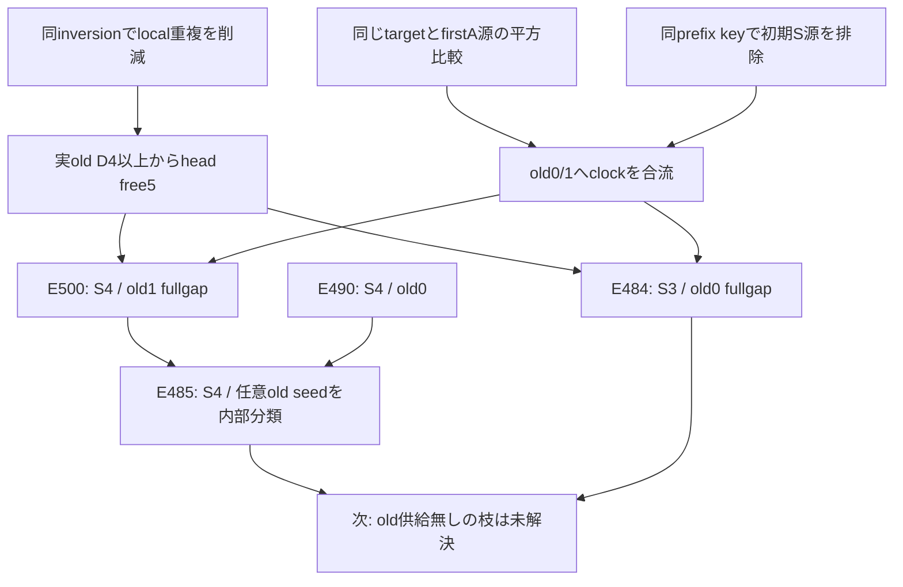

# 2026-11-01 C1: 同じtargetで平方を比較してfull-tailへ課金

E484/E485/E498/E499/E500はPROVED-LEAN（人間レビュー未）。全run長/old履歴/面積を量化する条件付きの枝定理であり、四run全体/C1/任意rank/全射性は未解決。既存未検証table、E483五area対、E384存在方向は使わない。

## 最終S3・targetmass3・oldclock0

head z=Sh AM Sm AL Ss AU はzero-mass、S=h+m+s=M+L+U、area=-B。元actual counterの第一A runは供給2以下なのでM<=R+1（R=j+1）を内部供給できる。同じold targetのkeyはku=2B-12S-18-2R²。firstA内源の残り長eとlocal clock iにはmass/keyから

`(M-e)^2 = B-8S+2iS+i²-2i`

が成立。同targetと結合すると

`2(M-e)^2 = 2R² + ku + 16 + 4(i-1)S + 2(i-1)^2`。

BlockWordのku>=-2、i>=1なら右辺は2R²より大きいが、0<=M-e<=Rに反する。従って第一A源はclock0だけ。既知の無条件firstAclock3/M11はM<=R+1を満たさず保持する。有限R6/四SB/16caseを列挙していない。

oldclock0と初期S local源はE490で非共存。全old供給は同じprefix上clock0へ合流し、第一Aも0。残る第二S/第二A/第三Sの三族各1とclock0/fixed2で最後rayの全供給<=5。E497が同じ実oldmass4/clock0からheadfree>=5を供給する。targetmass3/最終S3からT=Rを内部供給し、元count加法でfullfree>=5+(T-5)>=R。E484をPAPERから元Intp/padded/zero-fullpositiveのPROVED-LEANへ更新した。最終S local band存在も不要な強い結論。

## 最終S4・targetmass3・oldclock1

同targetはku=2B-12S-16-2R²。第一A源は

`2(M-e)^2 = 2R² + ku + 14 + 4(i-2)S + 2(i-1)^2`。

同じcounter第一A予算からi>=2を排除し0/1へ。初期S源はd=h-q=5-iを残す。同じoldclock1/mass4 sourceとの結合は

`ku = 4(1-i)(S+4)-2(5-i)^2`。

i>=1はBlockWord key下界-2に反し、i0はE497のS>=11とmass4 key上界6に反する。初期S源は全clockで無し。他old供給はclock1だけ、第一Aは0/1、fixed2と他三族でlast供給<=6。headfree5/T=R+1からfullfree>=R。E500のexplicitold1は元pでlocal band不要。

E485の任意old seed版はlocal bandと既存r3内部境界からcounterのj>=2を供給し、E441の同targetclock順序とT=j+2からoldclock0/1へ。old0は既存E490のv4/targetmass3、old1はE500で払い元pへ接着した。未証明source存在を仮定化せず、与えられた任意実old supplierのclockを内部分類する。

## 監査と停止

個別Leanは-M512/10CPU per-process/20wall、G5逐語statement、Audit登録。07:42全check543jobs/3163宣言成功、その後コピー元から残った誤ったmodule docstring（v>=4等）を実signatureのS3/S4へ訂正し同512MB再検査、最終check再実行。実際の量化子や数式は変更していない。

旧H01 scalar/firstA、LargeOldSeedGap、一般I25 monolithicのSTOPPEDを解除しない。今回のproofはE497の独立actual free供給と同target平方比較で、source/target/Rを有限に切らない新機構。pure算術helperを単独成果に数えず、元actual主定理の内部予算供給を確認した。

次の一問はH-20261102-01、最後rayにold供給がない枝。E497のheadfree5には早期old源が必要なのでその仮定を落として使わない。no-old枝の初期S/第一A/他local三族を同targetで結合してhead側に課金する必要がある。任意mixed futureの単射/rankは供給されていない。

## Final semantic audit map

この図のhead free5には早期old源が必要。no-oldへ矢印がそのまま通るという意味ではない。raw source/key budgetと元actual供給の境界を監査済み。
