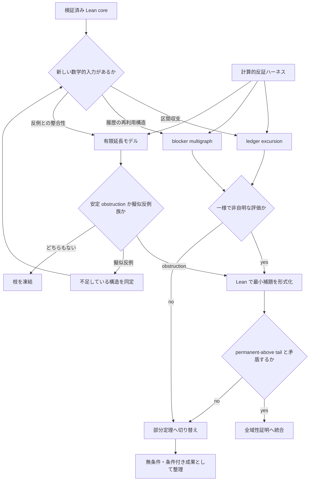

# Recamán 全域性研究ポートフォリオ

## 2026-09-10 の選別結果

[3時間研究](THREE_HOUR_RESEARCH_2026-09-10.md)で E-065 を任意有限 State・開始 clock の範囲で
`PROVED-LEAN` に昇格した。全 lag 容量 E-070 と全 A 同時供給不足 E-067 は未解決。
周期供給の研究を続ける理由はこの縮約だが、非周期軌道や全射性の直接決着とは区別する。

長 run の bounded-excess 拡張は Lean 証明できたものの、標準 10^7 で対象 0 件だったため追加最適化を停止した。
窓内の clean 構造へ移り、U≤11 と全長 clean の和集合の容量を Lean 証明した。
有限 P2 供給 A の 70.065% が対象に入り、NoSAAS 下で残余は SS を跨ぐ窓と分かった。
SS1 最小窓の二族分類と A run ごとの一件上限・単独容量は紙上、同じ SS への非有界需要は Lean。
続く E-128 は、S-ended prefix と共通端点の moment 障害から clean/SS1 の共同容量を Lean で閉じた。
NoSAAS・最小 lag・紙上分類への依存も除去した。ただし旧 short との和集合容量は未解決。
中央 charge、SS ごとの定数枠、10^7 の観測からの型 B 除外は反証済みで、修理を続けない。
phase energy は既存 κ の定数倍と監査で分かり、新たな機構としては停止した。

標準10^7で新対象は75.39988%だが、旧短距離7件は対象外（E-129）。
SS≤2への同じprefix正規化はcanonical step115で反証・Lean認証（E-130）。
続く SS=2 unit で先頭 run 兄弟（E-132）と孤立先頭の双対（E-135）を Lean 証明した。
名前付き課金と直前 S は反証（E-133, E-136）。入れ子 one-per-run は k=1 と k≥2 で Lean（E-137）。
NoSS mass1 の moment 下界（E-140）が短い前窓の残りを制限する。無制限 case5 は minWord 接着で反証（E-142）。
NoSS mass1 の分類と slack 3+8k+4a は Lean（E-145）。SS=3 extra は (SA)^k minWord（E-146）。
SS=2/3 の先頭 run 上限から NoSAAS を外した（E-166, E-167）。
次は孤立 singleton の S 配分（課金再開なし）、一般 SS の等号族 moment、または E-067/E-070。
同じ課金の修理はしない。
同じ正規化の直接拡張、型分類、有限通過、標準軌道の頻度だけを一般容量の代用にしない。
以下の日付付き記録は当時の判断を残す履歴であり、現在の gate は [frontier](CURRENT_FRONTIER.md) を参照する。

2026-09-09 [1時間研究](ONE_HOUR_RESEARCH_2026-09-09.md)：先頭A数からのsharpな全lag下界
d≥4m−1（E-090）、等号窓の分割分類（E-091）、入れ子間隔と保護S（E-092）を得た。
一般の周期接着・容量拡張もLean（E-095）で、既存のU≤15容量へm≥16の等号窓を
一括追加できる（E-093、既存写像の具体的適用は紙上）。
型表の延長ではなく、任意の長さを同じ式で扱う局所機構として保管する。
最小供給lagの単調増加は任意に長いA区間でも偽（E-094）。run長の閾値変更による修理は停止。
次は非等号窓と入れ子でない切り替わりを扱う独立した局所制約が必要。全lag容量は未解決。

2026-09-09追補：[減算の一回・二回先読み](HYPOTHESIS_CARD_2026-09-09_CATALYTIC_LOOKAHEAD.md)で
F_1/F_2をL=11のS辺から反証（E-089）。先読み回数の追加は停止。任意kや他のpotentialは未排除で、
再開には繰り返す供給再活性化を扱う構造を要求する。

2026-09-09 #73追補：[lag-11容量](ISSUE73_LAG11_CAPACITY_2026-09-09.md)をE-080 PROVED-LEANへ昇格。
任意周期で|U7∪U11min|≤|D|。lag-15和はE-086 PROVED-PAPER。型ごとのlag延長はE-088 STOPPED。
全lagのE-067/E-070は未解決。

2026-09-07 #73追補：[短い供給の容量](ISSUE73_PERIODIC_SUPPLY_2026-09-07.md)をE-071 PROVED-LEANへ昇格。
全periodでU7≤Dだが、全lagのE-067/E-070は未解決。escape selector、最古端S、second-moment符号、
all-A future debtの一単位支払はE-072〜075で停止。Hall・固定短写像のlag11拡張・有限automatonの
E-076〜078はCOMPUTEDで、一般capacityの証明として使わない。

2026-09-07並列調査追補：[5パターンの比較](PARALLEL_APPROACH_TRIAGE_2026-09-07.md)を実施した。
E-061の集計型要約、E-063のSS blocker birth時刻制約、E-064の静的連結support、E-068のhole-only
非空保存を、それぞれの反例・抽象no-goで停止。広い方式全体の不可能性とは扱わない。
④はE-065のfinite-lag供給への紙上縮約を得て、E-067/E-070の全period組合せ命題を次の候補にした。
E-066は有限証拠に留まり、E-069の最古S写像は非単射。固定周期の排除も非全射性を直接含意しない。

2026-09-07追補：[最新戦略地図](STRATEGY_MAP_2026-09-07.md)で#70・#71の有界作業を判定した。
E-056の任意F族はPROVED-LEAN。E-058の共同birth分類はCOMPUTEDで完了したが、
独立した大域不等式は得られず、正のsurvival攻略はE-059 STOPPED。再開には具体的な新不等式が必要。

2026-09-06時点の追補：[戦略地図](STRATEGY_MAP_2026-09-06.md)と[監査](STRATEGY_AUDIT_2026-09-06.md)で、
自由cutoffのfloorを非全射性へ合成するroute、一回使用や任意finite-prefix membershipだけの
survival route、canonical weighted-drop候補 `7J≤3(v-u)` を停止した。
前二者にはLean証明・反例、任意F版には紙上族、最後にはcanonical 20Bのholdout反例がある。
同じ定義・定数調整による再開を避け、phase離脱と共同birth生成の独立した定量入力を要求する。

> [!NOTE]
> 本書は2026-08-30時点のbranch scoreと停止理由を保存するhistorical portfolioである。
> 現在のactive/stopped判定は[`CURRENT_FRONTIER.md`](CURRENT_FRONTIER.md)、
> 証拠labelは[`EVIDENCE_REGISTRY.tsv`](EVIDENCE_REGISTRY.tsv)を参照する。

最終更新: 2026-08-30

> 同日の並列監査で、各枝の反例、縮約、有望度を更新した。
> 詳細は [PARALLEL_RESEARCH_2026-08-30.md](./PARALLEL_RESEARCH_2026-08-30.md) を参照。

## 2026-08-30時点の有望度

| 枝 | 直接証明 | 戦略価値 | 現在の判定 |
|---|---:|---:|---|
| low-quotient tail minimum + ledger | 15 | 85 | canonical high枝が空、直接枝停止 |
| tail interval Hall matching | 25 | 80 | 直接枝停止、部分定理候補へ移管 |
| arbitrary-history countermodel | 20 | 90 | 戦略フィルタとして常設 |
| `q ≥ 6 → G ≥ 0` | 15 | 80 | 独立枝停止、no-go例として保存 |
| generic blocker provenance | 20 | 70 | noncanonical部分定理として保存 |
| fixed blocker budget / reset injection | 5 | 80 | 棄却済み |

選抜後の二本スプリントまで完了し、ロードマップで定めた停止条件に到達した。canonical least-tailでは
high blocker枝が数値的に空であり、tail Hall条件も真なら非自明な線形成長定理を与えるが全域性矛盾には
届かない。従って全域性の直接攻略は凍結し、以後は形式化済み部分定理、経験的`TailHall₃`候補、
arbitrary-history/H6 no-go結果の整理を優先する。

## 目的

主目標は、標準 Recamán 数列

\[
a_0=0,\qquad
a_n=
\begin{cases}
a_{n-1}-n & (a_{n-1}>n\ \text{かつ未出})\\
a_{n-1}+n & (\text{それ以外})
\end{cases}
\]

がすべての自然数を通ることの証明または反証である。ただし、全域性だけを成功条件にすると、同値な難問を別名で再導入しやすい。そこで研究成果を次の四段階で評価する。

1. 全域性または非全域性の証明
2. 全域性を含意する、既知の同値変形ではない一様評価
3. 無条件の非自明な漸近定理・構造定理
4. 有望に見える戦略を厳密に棄却する反例・不可能性定理

## 既知の境界

次は新しい証明入力ではなく、停止済みまたは保守専用とする。

- `TargetTailReturn`、coverage time、tail start、return frequency の相互言い換え
- canonical history / mounted descent と canonical valley certificate
- 固定点 floor の列挙、prefix successor coverage、deep mex
- pinned configuration の cutoff 依存全列挙
- earlier-smaller `regenerate`
- subtraction parity だけを使う議論
- 型やラッパーを追加するだけの「進捗」

再開条件は、従来の残余命題を真に弱める一様な不等式、有限分類、または新しい単調量が先に得られた場合に限る。

## 探索枝

### A. ledger と tail excursion の重み付き評価

現在もっとも本証明に近い枝。既証明の

\[
a_n+2\,\mathrm{subSum}(n)=\mathrm{upperTri}(n)
\]

を、単なる恒等式ではなく区間評価にする。missing target を仮定した permanent-above tail 上で、tail minimum とその直前値の出現時刻を結ぶ区間を、増大する歩幅を持つ重み付き excursion として調べる。

候補成果:

- 区間の subtraction mass に、端点だけからは出ない上限・下限を与える
- tail minimum の制約から、許される符号列を一様に削る
- blocker と reset event を同じポテンシャルで償却する

継続ゲート:

- target と cutoff に依存しない区間不等式が一つ得られること
- その不等式が ledger identity と非負性だけの帰結ではないこと

停止条件:

- 二回の探索サイクルを通じ、得られる評価がすべて端点恒等式へ還元される
- 有限計算で候補不等式に反例が見つかる

### B. blocker multigraph と再利用の償却

forced addition の原因となる既出候補を blocker とし、時刻から blocker の最初または最後の出現へ重み付き辺を張る。単射は実データで偽なので、目標は blocker の再利用回数そのものではなく、再利用時の時間差・値差・介在する reset の総コストを抑えることである。

候補成果:

- 一頂点への総入射重みの一様評価
- blocker 再利用のたびに消費される単調な資源
- positive forced addition と nonpositive reset の区間別収支

継続ゲート:

- 多重辺を許しても成立する償却不等式を、小さい範囲と holdout 範囲の双方で確認できること

停止条件:

- 重みを変えても高再利用 blocker が無制限に収支を破る
- 評価に「その値が後で再訪する」という全域性同値の仮定が混入する

2026-09-05更新：`lockcand`のlocal first-visit producerは200億clockまで6型へ完全分類できたが、
一つのlocal `(n,r,w)`が任意多数の後続event式と両立する弱化history countermodelをLean化した。
従ってこのlocal provenance枝は継続ゲートを満たさず`STOPPED`。再開にはactual arc survivalを使う
strict landing-bottom descentまたはuniform finite-to-one chargeが必要（`E-043/E-044`）。

### C. 有界反例モデルと有限延長問題

証明だけでなく、missing target と整合する長い仮想 tail を構成できるかを調べる。正確な履歴制約を持つ有限延長問題と、制約を弱めた抽象モデルを分離する。

候補成果:

- 永久に target より上にいる tail の有限制約モデル
- 最小 UNSAT core からの局所補題抽出
- 弱いモデルでは無限反例が作れるが、実数列では破れる、という差分の同定

継続ゲート:

- horizon を伸ばして安定する obstruction pattern、またはパラメトリックな擬似反例族が得られること

停止条件:

- prefix を再生するだけで、一般化可能な obstruction も反例族も得られない
- 状態表現が履歴全体と同サイズになり、圧縮された数学的情報を持たない

### D. 計算的予想発見と反証ハーネス

計算は証明の代用ではなく、候補補題を早く殺す装置として使う。符号列、subtraction mass、blocker 再利用、run length、tail minimum 周辺の excursion を一度に記録し、発見区間と holdout 区間を分ける。

必須指標:

- `subSum(n) / upperTri(n)` と誤差項
- addition/subtraction run length と局所偏り
- blocker の重み付き再利用分布
- coverage 後の再訪までの距離と、その直前の reset 構造
- normalized height と局所 extrema

運用規則:

- 予想は先に固定し、指数的に離した holdout で検査する
- 反例が出た予想は修理を一回まで許し、二回目で停止する
- データ依存定数を含む命題は Lean 化しない

### E. 無条件の部分定理

全域性が直ちに動かない場合にも、同値変形ではない漸近成果を狙う。候補はあくまで研究課題であり、現時点の主張ではない。

- subtraction count / mass の上下密度
- `a_n` の二次上界より真に強い成長評価
- 訪問済み集合の密度または区間充填率
- tail minimum の無限回更新、あるいは更新間隔の評価
- blocker multiplicity 仮定の下での条件付き全域性

継続ゲート:

- statement が全域性と同値でなく、ledger identity の直系の系でもないこと
- 仮定付きなら、仮定が実データで独立に検証可能であること

### F. Recamán 型 variant を使う比較実験

有限記憶版、blocker multiplicity 有界版、選択規則を少し変えた版を小さな理論実験室として使う。目的は variant 自体の網羅ではなく、どの構造が tail return に十分かを切り分けることである。

継続ゲート:

- variant の定理が、標準数列について検証可能な一つの欠落補題へ翻訳できること

停止条件:

- 標準数列への transfer condition が元の全域性と同値になる
- variant 固有の技巧だけが増える

### G. 反証可能性を残す

全域性を前提に研究計画を固定しない。直接「欠けた値」を天文学的探索で探すのではなく、missing target が強制する符号列、ledger 収支、blocker graph の構造が長期的に整合するかを問う。整合する抽象反例モデルが得られれば、現在の不変量だけでは証明不能だという有用な否定結果になる。

## 優先順位と資源配分

当面の推奨配分は次の通り。

| 枝 | 配分 | 役割 | 次の判定材料 |
|---|---:|---|---|
| A. ledger excursion | 30% | 直接証明 | 新しい一様区間不等式 |
| B. blocker multigraph | 20% | 直接証明 | 多重再利用を許す償却則 |
| C. 有限延長 / 反例モデル | 20% | 証明と反証の分岐 | 安定 obstruction または擬似反例族 |
| D. 計算的反証 | 15% | 仮説選別 | holdout を通る候補補題 |
| E. 部分定理 | 10% | 成果の多様化 | 非同値な漸近 statement |
| F. variant | 5% | 構造分離 | 標準列へ移せる欠落補題 |

Lean での新規実装は原則として A–F のゲート通過後に行う。既存コードの soundness と build 維持は別枠の小さな固定費とし、証明探索の成果には数えない。

## 研究サイクル

### Sprint 0: 再現可能な観測基盤

- 現在の Python スパイクを高速で再現可能な probe に置き換える
- 指標、発見区間、holdout 区間、反例ログ形式を固定する
- A–C で使う共通語彙を紙上で定義する

完了条件: 同じ prefix から ledger、blocker、excursion の統計が一回で再生成できる。

### Sprint 1: 三本の短い理論スパイク

- A: endpoint 間の ledger 差分を tail-minimum 制約と結合する
- B: blocker 辺の重み候補を三種類以内に絞る
- C: 弱いモデルと正確な有限延長モデルの差を一例で示す

各スパイクの完了条件は、「真らしい説明」ではなく、証明可能な補題、具体的反例、または停止判断のいずれか一つである。

### Sprint 2: 選抜

- A–C を継続ゲートで採点する
- 上位二枝だけを次周期へ進める
- 落ちた枝は、再開条件を一文で残して凍結する

### Sprint 3: 数学から Lean への移送

- 紙上証明を、既存定理に依存しない最小 statement にする
- 小さい有限版ではなく、target/cutoff-independent な定理を先に置く
- `#print axioms` と全体 audit を通す

### Sprint 4: 全域性へ接続、または成果を切り出す

- 一様評価が得られた場合は permanent-above tail との矛盾へ接続する
- 届かない場合は部分定理、不可能性結果、計算データを独立成果としてまとめる
- 同値変形しか残らない場合は、全域性の直接攻略を一旦停止する

## 意思決定フロー

## 次の一手

次の一手は直接証明の続行ではなく、成果の切り出しである。

1. `LeastTailLedgerMinimum`と`LeastTailLedgerProvenance`を、canonical/noncanonicalの適用範囲が
   混同されない形で保守する。canonical witnessは
   `a_t<t+target`かつ`q=0 ∨ (q=1 ∧ r<target)`で、high blocker枝には入らない。
2. 経験的候補`TailHall₃`を独立部分定理として記録する。positive blocker jobをall-familyで数え、
   `p≥7`なら需要をsubtraction容量`k+3`で払えるという命題は500万項までsharpに成立した。
   真なら`liminf a_n/n≤3`が従うが、permanent-above tailとは矛盾しない。
3. `TailHall₃`に短い局所charging proofが見つかる場合だけ部分定理として再開する。canonical historyを
   大規模に再生する必要があるなら投資せず凍結する。
4. H6の全21本抽象suffixと自由履歴Hall反例を、新しい大域候補がcausal provenanceを本当に使うかの
   regressionとして残す。

全域性の直接攻略を再開する条件は、linear height、positive subtraction density、permanent-above性を
同時に矛盾させる新しい外部入力、またはold blocker/nonpositive resetを一様に排除する独立定理が先に
得られることである。

## 2026-09-07: #70 completed

E-056をPROVED-LEANへ昇格。任意finite F、seed density/range/parity、actual word、
first late landing/no-wrap/future wrap、positive blocker一回使用を同時に満たす一般反例族を認証した。
固定prefix inclusionだけでsurvivalを救う枝の停止理由がLeanで確定した。
[形式化カード](HYPOTHESIS_CARD_2026-09-07_ISSUE70_FORMALIZATION.md)を参照。

## 2026-10-22: C1 Qの独立な前半面積下界はSTOPPED

- 具体的候補Az>=0はREFUTED: `SAAA|SSSSAAAASAAA`, k1=4,q0=16でAz=-2。
  q0自身はF(q0)>gなので、これをQ/C1の反例とは呼ばない。Az>=1はz=Sでも偽。
- 再開条件: 修理した独立下界の追加仮定が完成Dから別に供給できる場合のみ。
  根拠なく定数を下げたり同じ上限探索を延長したりしない。
- N（走行最小値とその+1のAは非Endable）と個数制約だけでもQは出ない。
  自由tagモデルS^m A^(m+1)SS（m>=4）はZ=2m+3-m^2<0。
  実際のmomentを照合すると偽のEndableがあり、実語のQを反証していない。
- 進める入力はE-379のfresh-low部分場合とE-380のexact prefix context。
  残余は最低水準がq0前にしかない場合。局所面積候補R_C1は未証明で、E-506のTheorem Rとは別。
- 詳細・反例・再現・停止判断: [C1 Q note](RESEARCH_NOTE_2026-10-22_C1_Q.md)。

## 2026-10-22 C1 Q追加cycle: 停止方法と再開条件

[H-20261022-01](HYPOTHESIS_CARD_2026-10-22_C1_Q_MAKEUP.md)、[handoff](RESEARCH_HANDOFF_2026-10-22_MAKEUP.md)。
Q/C1自体はCONJECTURED。E-379〜E-384の新入力・部分領域を得たため、無変化cycleとは数えない。

### 2026-10-23の更新

E-385/E-386/E-387でa_z≤3の一様深さ4・全長Q・old P2排除をPROVED-LEANへ移した。
一般Q/C1はCONJECTURED。a_z≤4のE-388はCOMPUTEDで、kernel未検査。一般a_z≥5とrankは未解決。
E-389のS-gap/terminal wordが次のcertificate圧縮入力。最新は[DAILY](RESEARCH_HANDOFF_2026-10-23_DAILY.md)。

- 全prefix A≤2^r−1はSAAA|SSSSAAAASAのr2/A5/d2でREFUTED。終端d1の親命題は未反証。
- 修理P=A−2(d−1)≤2^r−1はr≤4で違反なしだが、任意rのstrict progressを供給できず一般rank方法はSTOPPED。
  再開は供給A前にslack≥3を与える独立な入力がある場合。有限rを増やすだけで再開しない。
- 実prefix r4 holdoutは28秒guardで782/3708context完了・1中断、同設定時間追加をSTOPPED。
  prefix-free modelの完了結果とは区別する。
- 新edgeと候補集合が変わったので連続無変化cycleは0（進捗による更新で、日付resetではない）。
  次は[r4 A-event macro simulation](HYPOTHESIS_CARD_2026-10-24_C1_FOUR_KERNEL.md)から。

- Azの独立非負はREFUTED、これを単独入力にする方法はSTOPPED。SAAA|SSSSAAAASAAAのAz=−2を保存。
  再開には元のDから独立に供給できる追加仮定が必要で、定数だけを下げて再走しない。
- Nと個数条件だけを残す自由Endable tag法はSTOPPED。S^m A^(m+1)の一様な弱化モデルで不足が出る。
  真のP2 momentを再び強制する別機構なしに再開しない。これはQの反例ではない。
- 固定A予算のS上限拡大はSTOPPED。590秒の旧探索は未完了で、E-380のprefix削減へ切替済み。
- prefix=SAAA、q0=80のR-negative/peak-five/deep-threeは各900秒でUNKNOWN、Y-triangleは120秒でUNKNOWN。
  **同じ設定への時間追加はSTOPPED**。新しい独立な制約入力で問いが変わるまで自動再実行しない。
  R/Y/深さの数学的候補をREFUTEDやPROVEDへ昇格させない。
- old spectrum緩和N=32はINFEASIBLE。共通prefixへの持上げはSAT時の義務であり今回は実行していない。
  これを無制限の深さ供給や、持上げ不能の証拠と呼ばない。

次はa_z≤3の一様な深さ4入力。E-383の32を単に増やすことを次unitにしない。

### 2026-10-24: r4 kernel method stopped; run families and joint prefix progressed

- E-390 proves actual arbitrary-gap macro soundness, including long-gap nonsupplied A and A11 controls.
  The12837-state kernel methods (whole table/function blocks/Nat blocks/split columns) hit resource guards.
  The method is STOPPED; E-388/r4 classification remains COMPUTED. Reopen only for a justified smaller
  quotient or measured checker improvement, never only a larger time/memory limit.
- E-392 proves arbitrary-future Q from16 explicit roots. Membership fromaz<=4 remains the missing edge.
- E-391/E-393/E-396/E-397 give finite first-supply checking, unbounded odd/even run constraints and one
  six-node supply motif. Their concrete shape/free-budget hypotheses remain visible; no general rank is supplied.
- E-395 refutes the internal claim of at most2 supplies after the fourth free A. Existing ASAAA|S5 A3 S4 A4 S A3
  has5; terminal deficit4 makes this a stronger-prefix counterexample, not a C1/Q counterexample.
  Model candidates26/actual pairs88, unpopulated planned holdout0. Do not repair2→5 without a new argument.
- E-394/E-398 restrict jointmass3/4 areas of the same prefix. The trip block realizes mass4 extremes9/13,
  so a blanket extreme-exclusion mechanism is rejected. E-399 gives one of10 representatives preserving all
  low-mass suffixes together. Do not choose a different representative for each window or discardmass>=5.
- New actual-word edges and candidate exclusions keep consecutive no-change cycles at0, not a date reset.
  Next: [fixed-root r4 candidate reduction](HYPOTHESIS_CARD_2026-10-25_JOINT_OLD_SUPPLY.md), first15min gate.
  Full C1/Q and az>=5 remain CONJECTURED. See [2026-10-24 DAILY](RESEARCH_HANDOFF_2026-10-24_DAILY.md).

- 07:44のE-399拡張: 同じrを全bへ保持し、必要mass3/4の実old窓/実endpoint A付きEndNを双方向に供給。
  次はこの接続の再証明ではなく固定代表r4モデルの候補削減評価。S飽和後のtrim massから低massを判定しない。

### 2026-10-25: general supply gap and context barriers

- E-400 COMPUTED: fixed ten low-mass roots remove only one projected state/edge; root totals grow to128149.
  The same ten-root large-table method is STOPPED; reopen only with measured mathematical sharing/quotient/pruning.
- E-401/E-406 PROVED-LEAN: arbitrary earlier tails behind explicit S separators, including an unbounded two-run family,
  have at most one later A when the actual original-base nonsupplied-A budget is zero. The shape/inequalities are assumptions.
- E-402 PROVED-LEAN: bounded-future local context erasure; E-403 COMPUTED:10106-state quotient with full independent product checks.
  Old-window mass/area are retained separately; quotient kernel simulation remains unproved.
- E-405 REFUTED: any fixed negative-buffer threshold without a future A budget. Uniform counterfamily is kernel checked.
  This is a refuted auxiliary erasure claim, not a C1/Q/orbit counterexample.
- E-407 PROVED-LEAN: every actual supplied A after j S steps obeys2j+2≤all previous A, with an all-j sharp family.
  This does not replace all A by nonsupplied A. The next gate is the independent true-history free-count question in
  [H-20261026-01](HYPOTHESIS_CARD_2026-10-26_FREE_GAP.md).
- Slow and linear single-file DAGs were voluntarily superseded after measured checker improvements; the pruned single-file
  DAG hit the fixed4GiB RSS guard. No time/memory extension of the same method. Same-state A-count layers are a separate,
  measured environment representation; the final result is recorded in E-404 and [DAILY](RESEARCH_HANDOFF_2026-10-25_DAILY.md).
- General az>=5/rank/C1/Q/H/SL remain unresolved. New edges reset the unchanged-cycle count to0 by progress, not by date.

### 2026-10-26: run-count入力と明確な停止

- E-408〜E-411/E-413/E-414はPROVED-LEAN。二A-runのzero/全positive不足では全長free-gapを供給。一般多runとC1/Q/H/SLは未解決。
- E-412の共通old-only予算付きr4は12837状態/40024辺から削減0/0。kernel<=3000 gate失敗で同大表方法STOPPED。独立した候補削減/小商なしに時間・メモリだけで再開しない。
- E-415の第三A-ray local<=2と一回の修理<=3はREFUTED。S10 A24 S21 A3 S4のclock2/3/9/11を保持。空BlockWord/元0/全positive不足のhistoryでも実現（literal COMPUTED）、local判定はLean済み。定数だけの追加修理はしない。親free-gap/C1は未反証。
- E-416 PROVED-PAPER（未Lean・人間レビュー未）はgeneric5run+old1予算から三run反例をfree4〜9/全A<=20/gap<=9へ縮約。S長は無制限。次は実count接着と次供給条件によるsource再利用制約を独立に供給する。
- 全prefix A<=2r+1は既知A10/r4 terminalで偽。次供給条件付き候補はCONJECTURED、三run16384 discovery/192holdout違反なしは一般証明でない。

## 2026-10-27: 停止と継続の更新（R-20261027-01）

- 完了: E416全長reductionのkernel接着、E418〜423実有限context、E428/E429 target source領域、E431 source再使用式。一般C1/r4未証明。
- H02 charge有限probe: 203125/252で新しいcharge2境界を供給せず方法STOPPED、命題CONJECTURED。上限追加なし。
- H10 exact共同old spectrum: R11まで647閉状態COMPUTED、R19は3001事前gateでSTOPPED。R7/R11 kernelはmacOS AS1GiB拒否で未起動、cap除去で再開しない。
- E426同mass幅4を用いたH13/r4はE427で削減0/0、12837/40024不変、kernel<=3000失敗。E412と合わせ同表枝の不変2回を維持する。全体cycleの新edgeは存在するため全体停滞と混同しない。
- H14の4410tuple checkerはLean512MBでSTOPPED。新しい因子divisor/parityへの数学的pruningを一回導入し、同512MB/10CPU/20wallでE428成功。資源追加による再開ではない。
- E430は第一A源を既存count+平方式だけで除く方法のREFUTED。数値free4/5は実EndNではなく、empty-old/head39の実free10〜12。自由tag履歴枝を再開しない。
- 次はE432の実三run族free>=2R-2のPROVED-PAPERをLeanへ（H-20261028-01）。失敗時は第二S起点targetの平方条件と実freeの新couplingへ切替。紙上/有限計算/条件付きsource制約をC1全体の証明にしない。

## 2026-10-28 allocation and stop decision

- Exploitation: E432族kernelと全M拡張を完了。第一A/中央S target源をE434/E435で排除し、old/初期Sへ集中。old same-source area/count E438–440とjoint-prefix tail edge E441が新情報、全体無変化counter0は日付resetではない。
- Local exploration: 初期S四対E436と全source上界E437を得たが、必要modelの有限0違反は全長証明ではない。posthoc133coreはOBSERVED。
- **STOPPED H-20261028-06**: literal133core check10CPU、単一修理fast monolith512MB。全tuple包含/actual count bridge未検証、sourceはpacket .lean.txt隔離。時間/メモリ追加、同jobをcompiled importへ移すだけでは再開しない。独立した数学的pruningか真に小さい完全certificateと測定改善が必要。親初期S不在はCONJECTURED。
- E441のkey差8/同massとj0再使用controlを保持。supplier mass>target massなのでmass>5の供給源切断は禁止。新しいsource順序は任意future injection/rankではない。
- E412/E427 r4同表は2連続0/0 STOPPEDを保持。E415/E405の反例を定数追加で修理しない。次はH-20261029-01、15分不変なら初期S全tuple数学的pruning25分/共通prefix-local衝突20分へ。監査超過は数学から引き、同親cycleのunit/CPUを二重加算しない。

## 2026-10-29: 三runを全長で完了、次は任意mixed source cut

E445 old/E450 initialSを全実countへ接着してE451三A-run free-gapを完了。旧H06 133core certificate方法はSTOPPEDを保持し、E448は独立した全tuple数式pruningに基づく二形証明。旧r4/停止probeへの資源追加なし。E446共同old-source制約とE452任意mixed-word A-before-source cutを次の入力とし、A->free/単射/rankを仮定しない。任意run数/C1/全射性は未解決。

### 10/29終盤の判断

- E456 PROVED-LEANは四run実供給19/反例free4..17/A36/j17の派生予算。全S/historyは無制限で不在未検査。一般k二次予算はPROVED-PAPER。数値上界を新しい大表や旧jobの再開理由にしない。
- 任意runのA-before-source cut E452/E454は通過したが、freeへの直置換はE453でREFUTED。定数の修理ではなく、源以降を含む重複のない課金へ切り替える。親四run/C1はCONJECTURED。
- 追加のcold512MB buildは既存ShortPeriodicSupply memoryでSTOPPED。任意のproof-constant extractorも一回のimport修理後512MBでSTOPPED。通常の全Lean build/G5/Auditは成功。失敗を成功やCPU0へ置換しない。
- 次の一問はH-20261030-01。全体の無変化連続回数0はE451/E454等の新edgeによる更新。旧r4同表枝2回0/0のSTOPPEDは維持し、日付によるresetはしない。

## 2026-10-30: source-conditioned四runとmoment帯

固定seed四run族だけはE464 PROVED-LEAN、一般H01/C1/four-run charge3はCONJECTURED。H01最終S-source候補をE457/E458/E461/E462で4..12/A29/j12へ縮約したが不在は未検査。E463 Nat幅coreと未Lean p幅adapterを区別。

- E459 REFUTED: S-source head-only free課金。fulltail17なのでC1反例ではない。
- E466 REFUTED: moment帯⇒local half。S10/B64/三runでもclock0、同じold targetが付かない。定数修理せずtarget/sourceをcoupleする。
- H14/H15無作為sample方法は予算終了でSTOPPED。全four-run charge3へ昇格しない。H16有限480seed tupleのpassは無制限の証明ではない。H17以後の全source二次式とold mass低分類が新しい数学的入力であり、同sampleへ時間を足していない。
- H02 combined19 projection、H06 literal43、H13 width adaptersの512MB失敗layoutはSTOPPED。幅のp版未Lean、同jobの資源/compiled移動だけの再開なし。旧H06/133core、旧r4 E412/E427二回0/0、R19/R7R11/cold512の停止も保持。
- E465 moment oldclockは一般mixed headに有効、local側は別。E467紙上二caseを実元0/pへ供給しlastfree1/2を調べる10/31 bounded unitを選ぶ。全体連続無変化0はE464/E465の新edgeによる更新で日付resetではない。親cycleR30の子unit/CPU/時間は二重加算しない。

## 2026-10-31: 四runのzero-mass moment/source枝（全長）

E482 PROVED-LEAN: 元Intp/padded/zero-fullpositive、正三A-run head A=S、area=-B、4S+4<=B<=6S+4、同じold target/最終S local bandから元full-tail free>=j+1。全S/run長/old履歴を量化し、E467〜478のmass1/2 source重複と実countを接着。lower4ではold<=1を捨てずheadfree6/local5で払う。一般四run/任意r/C1/全射性は未解決。r3 kernel count依存、未検証r4表/E384不使用、人間レビュー未。

E481 lower5の新境界はcounter域で空と意味監査し、新coverage進展に数えない。E480はold-erasureだけの実履歴反例。E483の帯外mass3/old4五area対はPROVED-PAPER（未Lean・人間レビュー未）でactualfree未接続。

次は[H-20261101-01](HYPOTHESIS_CARD_2026-11-01_MASS_THREE_ACTUAL_CHARGE.md)。[当日研究note](RESEARCH_NOTE_2026-10-31_C1_MOMENT_BAND.md)に全chainと失敗を保存。H19のfreshholdoutは未完了、H21 layoutは512MB STOPPEDで資源追加再開しない。

## 2026-11-01: 帯外old-seed枝と同target平方課金

E484/E485はPROVED-LEANへ更新。正三run zerohead/同old targetmass3で、S3/old0はlocal band不要、S4/任意old seedはfinal-band local付きの元Intp/padded/zero-fullpositive全長free-gap。E500 explicitold1はlocal band不要。E492は実old supplier mass>=5の枝とtargetmass>=4のold-seed枝をarea無制限で供給する。四run全体/C1/任意rankではない。

E487/491/493の同inversion joint/local予算→E496の実S13/I23..25/priorA12→六形E497で、早期oldD>=4のheadfree5（D>=5なら6）。E498/E499は同target primitive keyとfirstA源を平方比較してclock0又は0/1へ合流し、old0/1と初期S源の非共存を使ってlast5/6へ。actual counterから第一A予算を内部供給し、頭と最後の実countを同じ元pへ接着した。raw budget条件だけを解決としない。

旧scalar/firstA、LargeOldSeedGap、一般I25 monolithの512MB STOPPEDは保持。六形Orの巨大omega proofは同命題のexplicit constructorを同512MBで検査して採用、資源追加/compiled移動なし。E495一般I25 joint4は未Lean、D4 headfreeの帰結だけE497で別証明。E483五area対は未Lean、E388 COMPUTED/E404 CONJECTURED/E384未Leanを保持。全体無変化0は新edgeによる更新で、r4 E412/E427二回0/0 STOPPEDは日付resetしない。

次: [H-20261102-01 no-old last-ray](HYPOTHESIS_CARD_2026-11-02_NO_OLD_LAST_RAY.md)。old供給無しではheadfree5を使えない。非zerohead/他source位置/任意run数/rank/C1/Q/H/SL/全射性も未解決。詳細は[同target平方note](RESEARCH_NOTE_2026-11-01_C1_TARGET_SQUARE.md)と[当日DAILY](RESEARCH_HANDOFF_2026-11-01_DAILY.md)。

## 2026-11-02 method decisions

- R-20261102-01: C3全separatorとC>=4/v>=Cへ新しいsource/actual edges（E512〜520/E522）。全体連続無変化0は新edge由来で日付resetでない。既存r4表枝2回0/0はSTOPPEDのまま。
- H06低separator五tuple monolith: 200k heartbeats/512MB、一回の解析S>=12修理後も整数Or枝が閉じずSTOPPED。packet/intermediateへ隔離。独立したsource-prefix平方E514で親課題を閉じたが、このjobを再開しない。
- H13五band算術monolith: Nat/Int cast/grindと512MB kernel memoryでSTOPPED。依存actual adapterも未検証のままpacket隔離。E521はPROVED-PAPER、actual last3/4だけE522でkernel。再開はactual S上界からfactored-circleでstrict候補削減を供給する独立の数学入力を要する。時間/メモリ追加や単なるsplit/import移動は禁止。
- C4専用の個別成功5moduleと重複local6実装は一般版/既存AdjacentRunSupplyへ置換しlibrary不採用。module本数を新しい証拠数としない。
- 新C1反例なし。全source countと実freeを区別、E453 mass1/free-prefix反証を保持。

## 2026-11-03: 実count/factored-circleとendpoint前依存

E523 PROVED-LEAN: short counterのhead10/last4-3を元実partitionへ接着してS+v<=C+13/12、S>2C、D1 C<=5/deep v<=3を全old履歴/全長で供給。これを先に消費する明示五constructorでE521五band包含/C8-v4-R9-S19-A21/deep QをPROVED-LEANへ更新。旧11/02 monolithは停止保持で資源追加なし。五bandのcounter不在や有限history分類ではない。

E524 PROVED-LEAN: Winと現在endpoint-Aを同一視せず、targetの一clockだけAへ補完しstrict pastのEndN/free countを同じ基点で厳密保存。既存E451を消費して三runのWin-only gapを供給し、実short counterからT>=1/R>C-v。SAA/endpoint-SはWinだがEndNでないkernel境界で、親C1反例ではない。未知Prop/予算/free結論を入力していない。人間レビュー未、一般四run/C1/rank/全射性は未解決。

## 2026-11-03 actual old-target update

E-526/E-527は同zero-positive三run zerohead/oldtargetmass5のS2/S1、E-528/E-530はmass4/S3,S2の全長元p free-gap。E-529/E-531/E-532/E-533/E-534のsource/target/cross課金を経てE-535は残るC4/S1 actual counterをS14/R6/j5/T3/K19,20,21へstrict削減（PROVED-LEAN、人間レビュー未）。反例不在・一般C1は未証明。current frontier/当日target residual noteを正本とする。

H13のlocal8rowは個別kernel受理のみ、import/source分類512MB STOPPED、未検証source/finite certificateはpacket .lean.txtへ隔離、actual接着は未採用。再開は独立数学pruningと測定改善を要し、資源増加や単なるsplit/import移動は不可。E534/E535は独立target grammar入力。target以前prefixをBlockWordへresetする弱化補助仮定はSAAAA/drop1=A4/take1=SでREFUTED、C1反例ではない。

## 2026-11-04: same-target source-family frontier

E536/E537はK非平方の全長source排除でmass4/S1を元p freegapへ接続。E538〜545はC2のS1/S2/全v>=5/no-oldとC1mass1のoldmass2を元p fullgapへ。E548/E549はmass1のAS+2/cross0 source制約（Aでありfreeではない）。E551〜553はmass1/no-old actual counterをheadfree4/v<=2へ、E555/E556はd<=2二窓排除とv1 last5/free=jへ。E550 first供給1 shortcutはliteral2clockでREFUTED、親C1反例なし。

E546/E547 oldmass3/>=4、E554 small-separator initial source、E557 no-old全v source-family衝突はPROVED-PAPER、未Lean・人間レビュー未。H08/H10/H12/H13/H21 kernel512MB sourceはSTOPPED/packet隔離。E557はH21 global parityを入力せずinitialSをclock0へ保持する独立機構。旧r4表二回0/0等の停止は維持。全history分類/一般C1/Q/H/SL/全射性ではない。

次の正本は[H-20261105-01](HYPOTHESIS_CARD_2026-11-05_SAME_TARGET_FAMILY_COLLISION.md)、[11/04 DAILY](RESEARCH_HANDOFF_2026-11-04_DAILY.md)、[joint-source note](RESEARCH_NOTE_2026-11-04_C1_FAMILY_COLLISION.md)。
